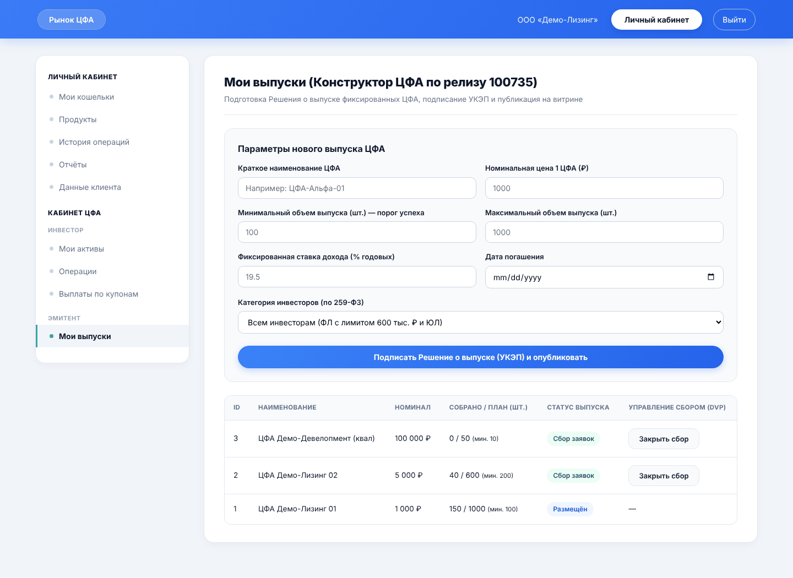
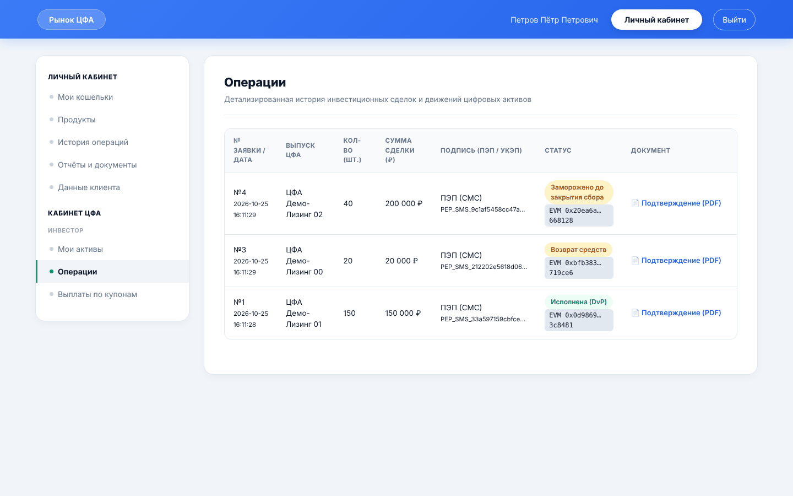
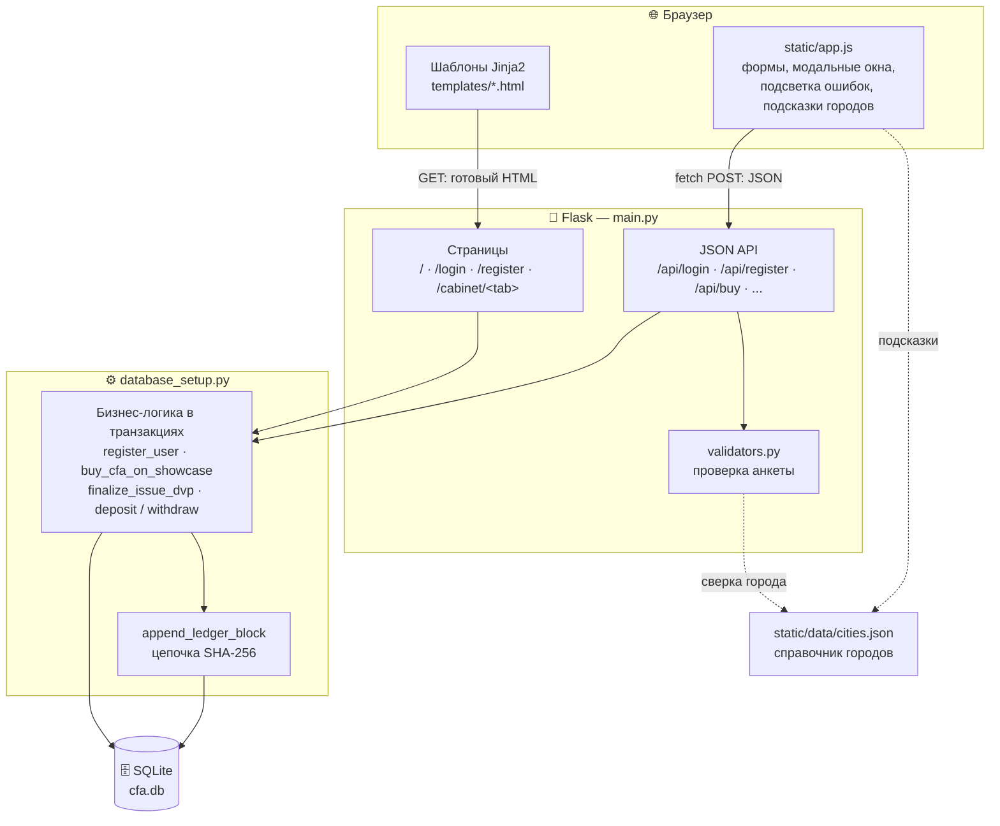
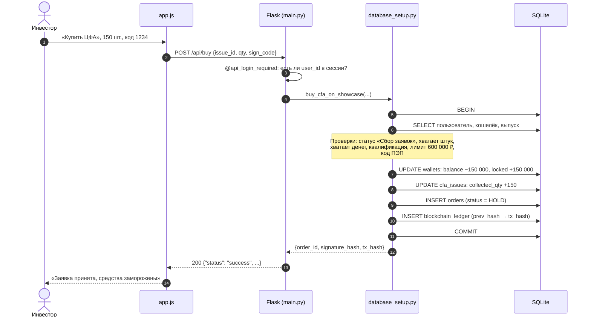
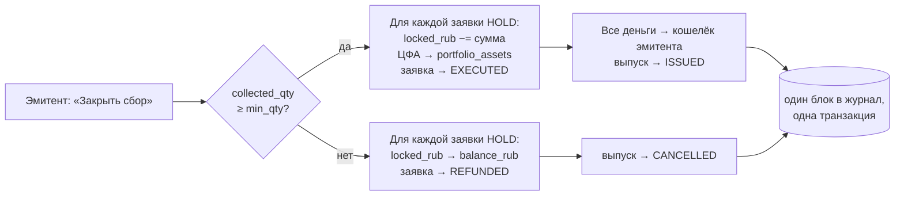
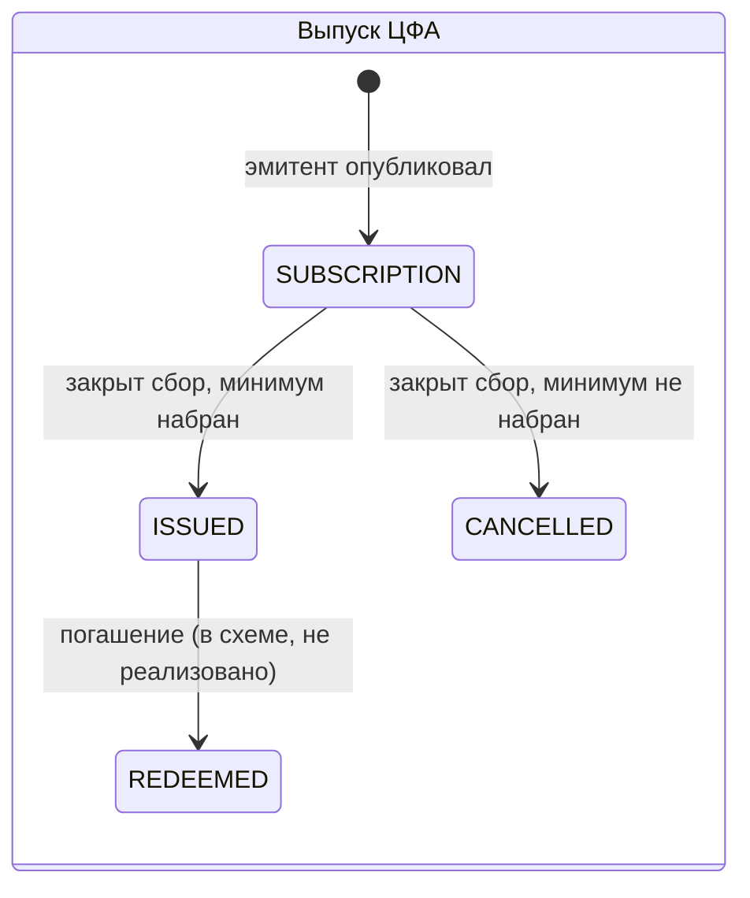
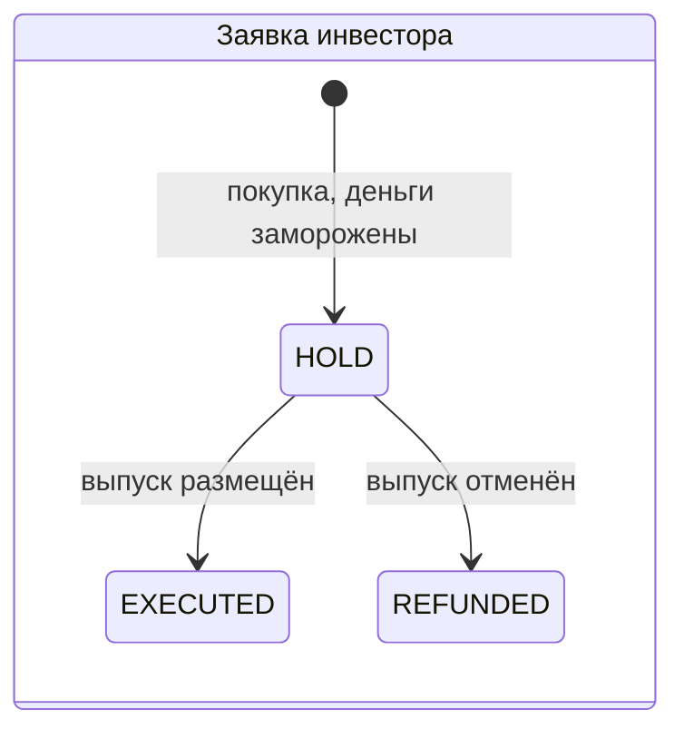
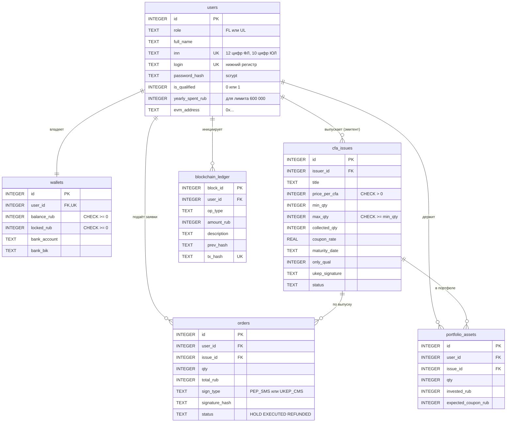

<div align="center">

# 🏦 Платформа ЦФА

### Прототип информационной системы для выпуска и обращения цифровых финансовых активов

Эмитент публикует выпуск → инвесторы подают заявки с заморозкой средств →
смарт-контракт **DvP** атомарно рассчитывает сделку или возвращает деньги.

<br>


<br>


</div>

---

## 📑 Содержание

- [О проекте](#-о-проекте)
- [Возможности](#-возможности)
- [Скриншоты](#-скриншоты)
- [Быстрый старт](#-быстрый-старт)
- [Демо-сценарий за 5 минут](#-демо-сценарий-за-5-минут)
- [Архитектура](#-архитектура)
- [Как проходит покупка ЦФА](#-как-проходит-покупка-цфа)
- [Жизненный цикл выпуска и заявки](#-жизненный-цикл-выпуска-и-заявки)
- [Структура проекта](#-структура-проекта)
- [База данных](#-база-данных)
- [Бизнес-правила](#-бизнес-правила)
- [Регистрация и проверка анкеты](#-регистрация-и-проверка-анкеты)
- [HTTP API](#-http-api)
- [Безопасность](#-безопасность)
- [Известные ограничения прототипа](#-известные-ограничения-прототипа)
- [Дорожная карта](#-дорожная-карта)
- [Нормативная база](#-нормативная-база)

---

## 💡 О проекте

**Цифровые финансовые активы (ЦФА)** — цифровые права (например, денежные требования),
которые выпускаются, учитываются и обращаются в информационной системе на основе
распределённого реестра. В России их регулирует закон **259-ФЗ**.

Проект — работающий прототип такой информационной системы (ОИС):

| Участник | Что делает на платформе |
|---|---|
| 🏢 **Юридическое лицо — эмитент** | Создаёт выпуск ЦФА (цена, объём, ставка, дата погашения), подписывает «Решение о выпуске» имитацией УКЭП, закрывает сбор заявок |
| 👤 **Физическое лицо — инвестор** | Пополняет цифровой кошелёк, покупает ЦФА на витрине с подтверждением СМС-кодом (ПЭП), видит портфель и ожидаемый купон |
| 🏦 **Юридическое лицо — инвестор** | Покупает ЦФА без годового лимита, подписывает заявки «УКЭП» |

Ключевая идея — **атомарный расчёт DvP** (*Delivery versus Payment*, «поставка против платежа»):
деньги инвесторов замораживаются на время сбора заявок, а при закрытии сбора одной транзакцией
либо все получают ЦФА, а эмитент — деньги, либо все деньги возвращаются. Промежуточных состояний не бывает.

Каждая операция дополнительно записывается в **журнал-цепочку хэшей** (`blockchain_ledger`):
каждый блок содержит SHA-256 предыдущего, поэтому подмену старой записи видно по разрыву цепочки.

---

## ✨ Возможности

<table>
<tr><th>Раздел</th><th>Что умеет</th></tr>
<tr><td><b>🔐 Вход и регистрация</b></td><td>

- Вход по логину и паролю, пароли хранятся только в виде хэша (scrypt)
- Регистрация физлица или юрлица: логин, пароль и анкета
- **Мгновенная подсветка ошибок** под каждым полем, та же проверка повторяется на сервере
- **Выпадающие подсказки городов** (1117 городов России) для места рождения и адресов
- Паспорт и ИНН представителя — только цифры, символы ввести нельзя
- Проверка возраста 18+, формата телефона, e-mail, ИНН, СНИЛС, ОГРН, КПП, БИК, расчётного счёта

</td></tr>
<tr><td><b>🛒 Витрина ЦФА</b></td><td>

- Карточки выпусков: статус, цена, доходность, объём, прогресс сбора
- Выпуски «только для квалифицированных инвесторов»
- Покупка в модальном окне с расчётом итоговой суммы и кодом подтверждения
- Просмотр «Решения о выпуске» с подписью УКЭП

</td></tr>
<tr><td><b>👛 Личный кабинет</b></td><td>

- **Мои кошельки** — свободный баланс, замороженные средства, EVM-адрес, банковские реквизиты, пополнение и вывод
- **Мои активы** — ЦФА в портфеле, вложенная сумма, эмитент
- **Операции** — заявки на покупку и их статусы (холд / исполнена / возврат)
- **Выплаты по купонам** — ожидаемый купонный доход и даты погашения
- **История операций** — журнал с хэшами транзакций
- **Отчёты** — выгрузка истории и портфеля в CSV (открывается в Excel)
- **Данные клиента** — профиль, статус квалификации, остаток годового лимита

</td></tr>
<tr><td><b>🏢 Кабинет эмитента</b></td><td>

- Конструктор выпуска с подписью «Решения о выпуске»
- Таблица своих выпусков с прогрессом сбора
- Кнопка «Закрыть сбор» → расчёт DvP или отмена с возвратом средств

</td></tr>
</table>

---

## 🖼 Скриншоты

| Вход | Регистрация: подсветка ошибок и подсказки городов |
|:---:|:---:|
|  |  |
| **Покупка ЦФА** | **Кабинет эмитента** |
|  |  |
| **Кошелёк: свободно и в резерве** | **Портфель после DvP** |
|  |  |
| **Заявки и их статусы** | **История операций с хэшами** |
|  |  |

> На скриншотах — вымышленные демо-участники и выпуски.

---

## 🚀 Быстрый старт

**Нужно:** Python 3.9 или новее. Больше ничего ставить не нужно: SQLite встроен в Python.

<details open>
<summary><b>🪟 Windows (PowerShell)</b></summary>

```powershell
git clone https://github.com/KISEL4KO/VTB_Hack.git
cd VTB_Hack
python -m venv .venv
.venv\Scripts\Activate.ps1
pip install -r requirements.txt
python main.py
```
</details>

<details>
<summary><b>🐧 Linux / 🍎 macOS</b></summary>

```bash
git clone https://github.com/KISEL4KO/VTB_Hack.git
cd VTB_Hack
python3 -m venv .venv
source .venv/bin/activate
pip install -r requirements.txt
python main.py
```
</details>

Откройте **http://127.0.0.1:5000**.

При первом запуске рядом с `main.py` автоматически создаётся пустая база `cfa.db`.
Она не хранится в репозитории (см. `.gitignore`), у каждого разработчика своя.

**Пересоздать базу с нуля** (удалит все данные):

```bash
python database_setup.py
```

> ⚠️ Миграций нет. Если вы изменили схему таблиц в `SCHEMA_SQL`, базу нужно пересоздать этой командой
> или просто удалить `cfa.db` — иначе сервер будет падать с ошибками вида `no such column`.

---

## 🎬 Демо-сценарий за 5 минут

База стартует пустой, поэтому для демонстрации нужны два участника: эмитент и инвестор.
Удобно открыть второго участника в окне инкогнито.

1. **Зарегистрируйте эмитента.** `/register` → «Для юр лиц». Пример корректных данных:
   `ООО «Демо-Лизинг»`, ОГРН `1187700000001`, ИНН/КПП `7700000001 / 770001001`,
   город `Москва` (выберите из списка), улица `Пресненская наб., д. 10`,
   паспорт представителя `4510654321`, ИНН представителя `770000000011`,
   счёт `40702810000000000001`, БИК `044525225`.
2. **Создайте выпуск.** Кабинет → «Мои выпуски»: цена `1000`, минимум `100`, максимум `1000`,
   ставка `18.5`, дата погашения в будущем. Выпуск появится на витрине со статусом «Сбор заявок».
3. **Зарегистрируйте инвестора-физлицо** во втором окне: дата рождения старше 18 лет,
   паспорт `4500123456`, ИНН `770000000022`, СНИЛС `11122233344`, телефон `+7 999 000-00-00`.
4. **Пополните кошелёк.** «Мои кошельки» → «Пополнить / Вывести» → `500000`.
5. **Купите ЦФА.** Витрина → «Купить ЦФА» → `150` шт., код подтверждения **`1234`**.
   В кошельке 150 000 ₽ перейдут из «Свободно» в «В резерве».
6. **Закройте сбор** от имени эмитента. Собрано 150 ≥ минимума 100 → выпуск «Размещён»:
   у инвестора ЦФА появятся в «Мои активы», у эмитента на кошельке +150 000 ₽.
7. Повторите с выпуском, где собрано **меньше минимума**, — при закрытии деньги вернутся инвестору.
8. Откройте «История операций» и «Отчёты» — там журнал с хэшами и выгрузка в CSV.

---

## 🏗 Архитектура

Классическое трёхуровневое веб-приложение без внешних зависимостей, кроме Flask.



**Каждый слой проверяет своё:**

| Слой | Ответственность |
|---|---|
| `static/app.js` | Удобство: подсветка ошибок до отправки, подсказки, расчёт суммы покупки |
| `main.py` | Кто пользователь (сессия), разбор запроса, коды ответа, сборка HTML |
| `validators.py` | Формат и смысл полей анкеты: главный «судья», обойти его из браузера нельзя |
| `database_setup.py` | Бизнес-правила (лимиты, балансы, статусы) внутри SQL-транзакций |
| SQLite (`CHECK`, `UNIQUE`, `FOREIGN KEY`) | Последняя линия защиты: отрицательный баланс или дубль ИНН база не примет, даже если в коде ошибка |

**Как ошибка доходит до пользователя:**
`raise ValueError("текст")` в бизнес-логике → откат транзакции → `except ValueError` в маршруте →
`{"status": "error", "message": "текст"}` с кодом 400 → `app.js` показывает текст в форме.

---

## 🔄 Как проходит покупка ЦФА



Если любая проверка не прошла, выполняется `ROLLBACK`: ни одна из записей не сохраняется.

**Закрытие сбора (DvP)** — `POST /api/issues/<id>/finalize`, только эмитент выпуска:



---

## 🔁 Жизненный цикл выпуска и заявки





**Движение денег в кошельке:**

```
balance_rub ──покупка──▶ locked_rub ──DvP──▶ кошелёк эмитента
     ▲                       │
     └───────отмена──────────┘
```

---

## 📁 Структура проекта

```
VTB_Hack/
├── main.py                  # Flask: страницы, JSON API, сессия, фильтры шаблонов
├── database_setup.py        # схема БД (6 таблиц) и вся бизнес-логика в транзакциях
├── validators.py            # проверка полей регистрации (сервер — главный «судья»)
├── requirements.txt         # зависимости: только Flask
├── cfa.db                   # база SQLite — создаётся при запуске, в git не попадает
│
├── templates/               # HTML-шаблоны Jinja2
│   ├── base.html            # общий каркас: шапка, подключение CSS/JS
│   ├── market.html          # витрина выпусков
│   ├── auth.html            # вход и регистрация (анкеты ФЛ и ЮЛ)
│   ├── _modals.html         # модальные окна: покупка, кошелёк, документы
│   ├── index.html           # исходный статичный прототип (маршрутами не используется)
│   └── cabinet/             # вкладки личного кабинета
│       ├── _layout.html     # боковое меню кабинета
│       ├── wallets.html     ├── assets.html      ├── operations.html
│       ├── coupons.html     ├── history.html     ├── reports.html
│       ├── profile.html     ├── products.html    └── issuer.html
│
├── static/
│   ├── style.css            # основная дизайн-система
│   ├── app.css              # стили вкладок, подсветки ошибок, выпадающих списков
│   ├── app.js               # вся логика на стороне браузера
│   ├── data/cities.json     # 1117 городов России для подсказок и проверки
│   └── img/                 # иллюстрации
│
└── docs/screenshots/        # скриншоты для этого README
```

---

## 🗄 База данных

SQLite, 6 таблиц. Схема описана в `SCHEMA_SQL` в `database_setup.py`.



| Таблица | Назначение | Важные ограничения |
|---|---|---|
| `users` | Участники: физлица и юрлица | `role IN ('FL','UL')`, `inn` и `login` уникальны, логин и хэш пароля обязательны |
| `wallets` | Один кошелёк на участника | `balance_rub ≥ 0`, `locked_rub ≥ 0` — уйти в минус невозможно |
| `cfa_issues` | Выпуски ЦФА | `price > 0`, `min_qty > 0`, `max_qty ≥ min_qty`, статус из 4 значений |
| `orders` | Заявки инвесторов | `qty > 0`, `total_rub > 0`, тип подписи и статус из фиксированных списков |
| `portfolio_assets` | Портфель инвестора | `UNIQUE(user_id, issue_id)` — покупки одного выпуска складываются в одну строку |
| `blockchain_ledger` | Журнал всех операций | `tx_hash` уникален, каждый блок ссылается на хэш предыдущего |

**Почему деньги в `INTEGER`, а не в `REAL`.** Дробные числа в компьютере неточны
(`0.1 + 0.2 = 0.30000000000000004`), для денег это недопустимо. Суммы хранятся в целых рублях.

**Внешние ключи** в SQLite по умолчанию выключены и включаются в `get_connection()`
командой `PRAGMA foreign_keys = ON` для каждого соединения.

---

## 📜 Бизнес-правила

### Покупка на витрине — `buy_cfa_on_showcase`

| Проверка | Для кого | Ошибка |
|---|---|---|
| Выпуск в статусе «Сбор заявок» | все | «Сбор заявок по этому выпуску уже закрыт» |
| Не больше остатка штук | все | «На витрине осталось всего N шт.» |
| Хватает свободных средств | все | «Недостаточно свободных средств» |
| Выпуск не «только для квалов» | ФЛ без квалификации | «Доступен только квалифицированным инвесторам» |
| Годовой лимит 600 000 ₽ | ФЛ без квалификации | «Превышен годовой лимит… Доступный остаток: …» |
| Код ПЭП равен `1234` | ФЛ | «Неверный СМС-код ПЭП» |
| Код не пустой (входит в хэш «УКЭП») | ЮЛ | «Введите код подтверждения» |

### Выпуск ЦФА — `create_cfa_issue`
Выпускать могут только юрлица (`role = 'UL'`). Подпись «Решения о выпуске» имитируется
хэшем от ИНН эмитента, названия, цены и объёма: `UKEP_SIG_` + SHA-256.

### Купон
`expected_coupon_rub = сумма × ставка / 100` — годовой купон без учёта срока до погашения.

### Журнал-цепочка — `append_ledger_block`

```
prev_hash = tx_hash последнего блока  (у первого блока — 64 нуля)
raw       = prev_hash | user_id | op_type | amount_rub | description | timestamp
tx_hash   = "0x" + SHA-256(raw)[:62]
```

Блок пишется **в той же транзакции**, что и денежная операция: либо сохраняется и то и другое, либо ничего.

---

## 📝 Регистрация и проверка анкеты

Правила записаны дважды, с одинаковыми текстами ошибок:

- в `static/app.js` — чтобы подсвечивать поле, как только пользователь из него ушёл;
- в `validators.py` — чтобы некорректные данные не попали в базу, даже если JavaScript отключён или подделан.

Сервер возвращает ошибки по полям: `{"errors": {"fl_inn": "ИНН физического лица — 12 цифр."}}`,
и браузер подсвечивает именно эти поля.

### Учётная запись

| Поле | Правило |
|---|---|
| Логин | 3–32 символа: `a-z`, `0-9`, `_ . -`; регистр не важен; уникален |
| Пароль | 8–64 символа, хотя бы одна буква и одна цифра |
| Повтор пароля | совпадает с паролем |

### Физическое лицо

| Поле | Правило |
|---|---|
| ФИО | 2–4 слова, только буквы и дефис |
| Дата рождения | календарь; дата существует, не в будущем, возраст 18–120 лет |
| Место рождения | подсказки городов; можно ввести и свой населённый пункт |
| Гражданство | не короче 2 символов |
| Телефон | российский: `+7` / `8` и 10 цифр, сохраняется как `+7XXXXXXXXXX` |
| E-mail | вид `user@example.ru` |
| Серия и номер паспорта | **ровно 10 цифр**, символы ввести нельзя |
| Кем выдан | содержит код подразделения `000-000` |
| Город регистрации | **только из списка** городов |
| Улица, дом, квартира | есть буквы и номер дома |
| ИНН / СНИЛС | 12 / 11 цифр; ИНН не должен быть уже зарегистрирован |
| Статус инвестора | неквалифицированный (лимит 600 000 ₽ в год) или квалифицированный |

### Юридическое лицо

| Поле | Правило |
|---|---|
| Сокращённое наименование | начинается с формы собственности: `ООО`, `АО`, `ПАО`, `ИП`, … |
| ОГРН / ОГРНИП | 13 / 15 цифр |
| ИНН / КПП | формат `ИНН / КПП`: 10 и 9 цифр |
| Город юридического адреса | **только из списка** |
| Улица, дом, офис | есть буквы и номер дома |
| ФИО представителя | начинается с фамилии и имени |
| Паспорт представителя | **ровно 10 цифр** |
| ИНН представителя | **ровно 12 цифр** |
| Расчётный счёт / БИК | 20 цифр / 9 цифр, начинается с `04` |

### Справочник городов
`static/data/cities.json` — 1117 городов России с регионами из открытого набора
[hflabs/city](https://github.com/hflabs/city), отсортированных по населению: крупные города в подсказках идут первыми.
Поиск не зависит от регистра и букв «е/ё». Если город введён целиком и однозначен («сургут»),
он подставится сам; если неоднозначен («Кировск» есть в двух регионах), поле попросит выбрать вариант из списка.

---

## 🔌 HTTP API

Все `POST`-запросы принимают и возвращают JSON. Авторизация — cookie сессии Flask, которую ставит `/api/login` или `/api/register`.

| Метод | Путь | Доступ | Тело запроса | Успешный ответ |
|---|---|---|---|---|
| `POST` | `/api/register` | все | `{role: "fl"\|"ul", fields: {...}}` | `{status: "success"}` + вход |
| `POST` | `/api/login` | все | `{login, password}` | `{status: "success"}` |
| `GET` | `/api/issues` | все | — | массив всех выпусков |
| `POST` | `/api/issues` | вход, только ЮЛ | `{title, price_per_cfa, min_qty, max_qty, coupon_rate, maturity_date, only_qual}` | `{issue_id, ukep_signature, tx_hash}` |
| `POST` | `/api/issues/<id>/finalize` | вход, только эмитент выпуска | — | `{result: "ISSUED", total_raised_rub, tx_hash}` или `{result: "CANCELLED", tx_hash}` |
| `POST` | `/api/buy` | вход | `{issue_id, qty, sign_code}` | `{order_id, signature_hash, tx_hash}` |
| `POST` | `/api/deposit` | вход | `{amount_rub}` | `{tx_hash}` |
| `POST` | `/api/withdraw` | вход | `{amount_rub}` | `{tx_hash}` |

**Страницы:** `/` (витрина) · `/login` · `/register` · `/logout` ·
`/cabinet/<tab>` (`wallets`, `products`, `history`, `reports`, `profile`, `assets`, `operations`, `coupons`, `issuer`) ·
`/reports/ledger.csv` · `/reports/portfolio.csv`.

### Коды ответа

| Код | Когда |
|---|---|
| `200` | успех |
| `400` | ошибка данных: `{status: "error", message, errors?: {поле: текст}}` |
| `401` | не выполнен вход — `app.js` сам перенаправит на `/login?next=…` |
| `403` | закрыть сбор пытается не эмитент этого выпуска |

### Пример: покупка

```http
POST /api/buy
Content-Type: application/json

{"issue_id": 2, "qty": 10, "sign_code": "1234"}
```

```json
{
  "status": "success",
  "order_id": 7,
  "signature_hash": "PEP_SMS_3f9a0c1d2e4b5a6c7d8e",
  "tx_hash": "0x25abcb0ae9e97ad1..."
}
```

### Пример: ошибка регистрации

```json
{
  "status": "error",
  "message": "Проверьте поля, выделенные красным.",
  "errors": {
    "fl_passport_num": "Ровно 10 цифр без пробелов и символов: серия (4) и номер (6).",
    "fl_reg_city": "Начните вводить название и выберите город из списка."
  }
}
```

---

## 🛡 Безопасность

**Что сделано:**

- 🔑 **Пароли не хранятся** — только хэш `werkzeug.security` (scrypt с солью)
- 🙈 Одинаковое сообщение «Неверный логин или пароль» — по ответу нельзя узнать, существует ли логин
- 🔄 При входе старая сессия очищается — защита от фиксации сессии
- 💉 Все SQL-запросы параметризованы (`?`) — защита от SQL-инъекций
- 📋 Вкладки кабинета проверяются по белому списку — в путь к шаблону нельзя подставить произвольную строку
- 🧱 Ограничения `CHECK` / `UNIQUE` / `FOREIGN KEY` на уровне базы
- ⚛️ Денежные операции атомарны (`with conn:` = транзакция)
- 🔗 Редирект после входа — только на внутренние адреса (`/…`, не `//…`)
- 🧼 Подсказки городов выводятся через `textContent` — защита от XSS

> ⚠️ **Это прототип для хакатона, не production.** Перед реальным использованием нужны:
> секретный `SECRET_KEY` из переменной окружения (сейчас есть значение по умолчанию),
> выключенный `debug=True`, CSRF-токены, ограничение попыток входа, HTTPS,
> настоящие ПЭП/УКЭП и платёжный шлюз.

---

## 🚧 Известные ограничения прототипа

| Что | Подробности |
|---|---|
| Подписи и коды | СМС-код ПЭП всегда `1234`, «УКЭП» — это хэш, а не криптографическая подпись |
| Пополнение кошелька | Деньги появляются без реального платежа |
| Годовой лимит при отмене | При отмене выпуска `yearly_spent_rub` у физлица не уменьшается — лимит «сгорает» |
| Проверка журнала | Время, участвующее в хэше блока, не сохраняется, поэтому цепочку нельзя пересчитать и проверить |
| Купоны и погашение | Купон считается за год без учёта срока, выплат нет, статус `REDEEMED` не реализован |
| Параллельные покупки | Нет `CHECK (collected_qty <= max_qty)`, при одновременных заявках теоретически возможен перебор объёма |
| Данные анкеты | Дата и место рождения, гражданство и полномочия представителя проверяются, но не сохраняются в БД |
| Адреса | Подсказки только по городам, улица вводится вручную |
| Миграции | Нет: при изменении схемы базу нужно пересоздать |
| Тесты | Автотестов пока нет |

---

## 🗺 Дорожная карта

- [ ] `verify_ledger()` — проверка целостности цепочки хэшей и демонстрация обнаружения подмены
- [ ] Смарт-контракт на Solidity в локальной EVM-сети (Hardhat / Anvil) + `web3.py`:
      токен выпуска с белым списком адресов и **DvP против токенизированного рубля** одной транзакцией
- [ ] Погашение выпусков и выплата купонов с учётом срока
- [ ] Возврат годового лимита при отмене выпуска
- [ ] Автотесты на `pytest` для бизнес-логики и API
- [ ] Подсказки адресов до дома (например, через DaData)
- [ ] CSRF-защита, ограничение попыток входа, конфигурация через `.env`
- [ ] Docker-образ для запуска одной командой

---

## ⚖️ Нормативная база

Прототип моделирует требования, на которые ссылается код:

- **Федеральный закон № 259-ФЗ** «О цифровых финансовых активах, цифровой валюте…» —
  выпуск ЦФА юрлицами, учёт в информационной системе.
- **Указание Банка России № 5635-У** — ограничение для неквалифицированных инвесторов:
  ЦФА с определёнными признаками можно приобретать на сумму не более **600 000 ₽** в год.

> Прототип не является лицензированной информационной системой и не предназначен для операций с реальными активами.

---

<div align="center">

Сделано для хакатона ВТБ · автор — [@KISEL4KO](https://github.com/KISEL4KO)

</div>
